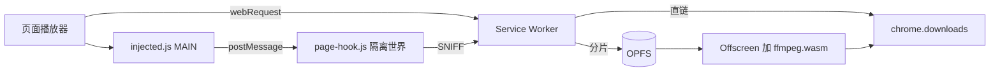

# 技术文档

这份文档描述仓库里已经实现的行为。产品范围和分期仍以 [方案.md](方案.md) 为准；方案写于开工前，和代码不一致时以代码和本文为准。

第一期：Manifest V3 扩展。用户授权当前站点后，按标签页嗅探直链和 m3u8。直链直接保存。HLS 点播（多清晰度、MPEG-TS、fMP4、AES-128、音视频分轨）在本机封装成 MP4。直播和 DASH 只出现在列表里，不能下载。

地址、分片、密钥都留在本机。扩展不把播放地址发到作者的服务器。

## 运行单元



| 单元 | 文件 | 职责 |
|---|---|---|
| Service Worker | `entrypoints/background.ts` | 嗅探、授权后的脚本注册、任务调度、角标。不持有大文件，也不跑 ffmpeg。 |
| 隔离世界脚本 | `entrypoints/page-hook.ts` | 读 `<video>` / `<audio>` 的 `currentSrc` 和页面标题，把 MAIN world 的消息转给后台。 |
| MAIN world 钩子 | `entrypoints/injected.ts` | 钩住页面的 `fetch` 和 `XMLHttpRequest`，只上报地址。 |
| 弹层 | `entrypoints/popup/` | 授权、列表、清晰度、进度。不自己下载。 |
| Offscreen | `entrypoints/offscreen/` | 用 ffmpeg.wasm 把分片封装成 MP4，再交给 `chrome.downloads`。 |
| 下载内核 | `src/lib/` | 播放列表解析、分片下载、解密、OPFS、声明式请求头。 |

页面脚本不是 WXT 的 content script 入口。文件名如果匹配 `content.ts`，WXT 会在构建期把 `host_permissions` 写成 `*://*/*`。这两个脚本用 `defineUnlistedScript`，构建产物是扩展根目录的 `page-hook.js` 和 `injected.js`。用户授权之后，后台才用 `chrome.scripting.registerContentScripts` 按已授权来源注册，并对已经打开的标签页再 `executeScript` 一次。

## 权限

`wxt.config.ts` 里 `host_permissions` 是空数组，`optional_host_permissions` 是 `http://*/*` 和 `https://*/*`。安装时不读任何网站。

弹层的「允许访问」调用 `chrome.permissions.request`，来源是当前页的 `origin/*`。播放列表或分片在别的源（CDN）上时，下载会抛 `NeedOriginsError`，弹层再要一次这些源的授权。

`webRequest` 能看到请求，但不能改请求头。播放页的 Referer 和 Origin 用 `declarativeNetRequest` 的会话规则补上，见 `src/lib/referer-rules.ts`。规则条件是 `tabIds: [chrome.tabs.TAB_ID_NONE]`，只作用于扩展自己发出的请求，不改页面里正在播放的请求。规则 id 从 1000 起。Service Worker 每次启动先清掉这个区间里的旧规则。

Cookie 不写进规则。扩展自己的 `fetch` 使用 `credentials: "include"`。

## 嗅探

一条资源进列表，要同时满足：

- 当前页已经授权。
- 地址是 http 或 https。`blob:` 进不了 `isHttpUrl`，直接丢掉。
- `classifyUrl` 或 `classifyMime` 判定为可列出的直链、HLS 或 DASH。
- 直链的 `Content-Length` 未知，或者不小于 100KB。更小的多半是片头预览。

三个来源，后到的补全同一条记录，不新插一行：

1. `chrome.webRequest.onCompleted`。至少授权一个来源之后才注册，过滤条件只用这些来源。安装时没有站点权限却监听全站，Chrome 会报 “You need to request host permissions”。忽略 `tabId < 0` 和扩展自己发起的请求，否则正在下载的分片会再出现在列表里。也忽略图片、样式、脚本、字体。`documentUrl` 在运行时有，类型定义里没有，代码做了交叉断言。
2. MAIN world 钩子。地址或 MIME 已经能认出媒体时直接上报。扩展名和类型都含糊（例如 `text/plain`、`application/octet-stream`，或根本没有类型）时，克隆响应，只读前 256 字节，看到 `#EXTM3U` 才当 m3u8 上报，然后 `cancel` 这个 reader。取消的是克隆体，页面播放器仍读原来的响应。
3. 隔离世界扫描 `video` / `audio` 的 `currentSrc`。DOM 变化、`play`、`loadedmetadata` 以及每 2 秒都会扫一次。

去重键是 `pathKeyOf`：`origin + pathname`，去掉 query 和 hash。带签名的同一文件每次查询不同，仍是一条。记录 id 是 `标签页 id:pathKey`。

`.ts` / `.m4s` 的 `listable` 是 false。`mergeDetection` 遇到这种地址结果就不再看 MIME，避免 `video/mp2t` 把分片列成直链。

同一标签页的 `origin + pathname` 变了，列表清空。只变查询参数（登录回跳、播放进度）不清。关掉标签页时清掉该页的列表；已经在拉分片或封装的任务不跟着取消。

角标是该标签页的条数，超过 99 显示 99，颜色 `#0f766e`。

## 状态

会话状态在 `chrome.storage.session`，键名 `cvd-state`。浏览器关掉就没了。结构是按标签页分的资源列表，加上全局任务数组。

`updateState` 把读写串进一条 Promise 链。嗅探是并发的，不串行的话后写会盖掉前写。变更函数返回 `false` 时不写存储。页面脚本每 2 秒上报一次标题，内容没变就不要触发弹层重绘。

弹层不保存自己的任务副本。它发 `GET_STATE`，并监听 `chrome.storage.session.onChanged` 再拉一次。

任务状态：

| 状态 | 含义 |
|---|---|
| `queued` | `startJob` 刚创建，马上会被写成下一状态。 |
| `resolving` | 正在读 m3u8。 |
| `fetching` | 正在下分片或直链。 |
| `muxing` | Offscreen 正在封装。 |
| `saving` | 正在交给 `chrome.downloads`。 |
| `done` | 文件已保存。HLS 的 OPFS 目录已删。 |
| `failed` | `error` 是给用户看的短句。OPFS 留着，直到用户清除。 |
| `cancelled` | 用户取消，或关掉标签页时任务还在排队。OPFS 已删。 |

全局同时只有一个活动任务，看 `controller.ts` 里的 `running`。这张表在内存里。Service Worker 被回收后表是空的，启动时 `failInterruptedJobs` 把非终态任务标成「扩展中断了这次下载，请重新开始」。不续传。

`START` 之后不要再 `saveJob`。`startJob` 自己会把状态写成 `resolving` 或 `fetching`，外层再保存会盖回 `queued`。

## 消息

弹层和页面脚本发给后台：

| type | 谁发 | 作用 |
|---|---|---|
| `GET_STATE` | 弹层 | 返回当前标签页的 `PopupState`，包含是否开启。 |
| `SET_ENABLED` | 弹层 | 打开或关闭嗅探。状态记在 `chrome.storage.local`，键名 `cvd-enabled`，缺省为开。 |
| `INJECT` | 弹层授权之后 | 按已授权来源重新注册并注入脚本。 |
| `SNIFF` | page-hook | 上报一条媒体地址。 |
| `PAGE_META` | page-hook | 更新标题和播放页 URL，作为后续 Referer。 |
| `RESOLVE` | 弹层 | 读 m3u8，区分主列表和媒体列表。不开始下载。 |
| `START` | 弹层 | 开始直链或指定清晰度的 HLS。 |
| `CANCEL` | 弹层 | 中止任务；若正在封装，再给 offscreen 发 `MUX_CANCEL`。 |
| `DISMISS` | 弹层 | 删掉任务记录和 OPFS。 |

后台和 offscreen 走名为 `offscreen` 的 Port，不走一次性消息。分片字节不进消息体。

| type | 方向 | 作用 |
|---|---|---|
| `MUX` | 后台 → offscreen | 按 OPFS 里的 `manifest.json` 封装并保存。 |
| `MUX_CANCEL` | 后台 → offscreen | 取消当前下载并 `terminate` ffmpeg。 |
| `MUX_SAVING` | offscreen → 后台 | 封装完成，开始保存。任务改成 `saving`。 |
| `MUX_DONE` / `MUX_ERROR` | offscreen → 后台 | 结束 `muxJob` 里等待的 Promise。30 分钟没回音算超时。 |

## 直链

`chrome.downloads.download` 先试一次。它不一定带上声明式网络请求改过的 Referer。失败后扩展自己 `fetch`（带 Cookie），再把 Blob 交给下载管理器。403 和 410 不再试，提示重新播放。取消时调用 `chrome.downloads.cancel`。

## HLS

`src/lib/m3u8.ts` 自己解析播放列表，不使用 hls.js。

主列表按带宽从高到低排序。弹层把第一档标成「最高」。用户点某一档后，`START` 带上该档的 URI。没有选档时用第一档。

媒体列表没有 `#EXT-X-ENDLIST` 时直接失败，文案是「直播留到下一期」。第一期不轮询。

`#EXT-X-KEY`：

- `METHOD=NONE` 或没有密钥：明文。
- `METHOD=AES-128` 且 `KEYFORMAT` 缺省或为 `identity`，并且 URI 是 http(s)：下载密钥，用 Web Crypto AES-CBC 解密后再写入 OPFS。播放列表没写 IV 时，用媒体序号的 16 字节大端整数。
- `SAMPLE-AES`，或其他 `KEYFORMAT`：当成 DRM，失败。密钥在 CDM 里，播放列表给不出能解密的字节。

`#EXT-X-MAP` 表示 fMP4。初始化段在分片变化时单独存成 `map-xxxxx.mp4`。`#EXT-X-BYTERANGE` 省略 offset 时，接着上一个范围的末尾，请求用 `Range`。

同一清晰度若有 `#EXT-X-MEDIA` 音频组，且视频的 `CODECS` 里没有音频，就再下一份音频列表。音频 URI 缺失时失败，而不是封装出一个无声文件。有 URI 时选 `DEFAULT`，否则 `AUTOSELECT`，否则该组第一条。

分片并发 4。单次超时 20 秒，最多再试 3 次，退避 300 / 900 / 2000 毫秒。403 和 410 不重试。一个分片失败会取消同一批里其余的请求。

每个分片先解密再写入 `jobs/<jobId>/`。视频在 `v/`，音频在 `a/`。写完后如果总字节超过 1.5GB，就不再封装。ffmpeg.wasm 的堆大约 2GB，封装时还要把分片再拼进一份内存，所以阈值留在 1.5GB。用户看到的文案是「约 2GB 上限」。

`manifest.json` 只记文件名、相对路径和 `ts` / `fmp4`。Offscreen 按路径读出，拼成一条输入，执行：

```text
ffmpeg -i video -c copy [-i audio -map 0:v:0 -map 1:a:0] [-bsf:a aac_adtstoasc] -movflags +faststart out.mp4
```

MPEG-TS 先加 `aac_adtstoasc`。这一步失败就再试一次不带滤镜的复制。成功后 `terminate` ffmpeg，用 Blob 交给 `chrome.downloads`。ffmpeg 读出的 `Uint8Array` 不能直接当 `BlobPart`，要拷进一份新的 `ArrayBuffer`。

核心文件来自 `@ffmpeg/core`，构建时复制到 `public/ffmpeg`。这个包是 GPL-2.0-or-later，许可证说明写在 `public/ffmpeg/LICENSE.txt`。`scripts/copy-ffmpeg.mjs` 把 worker 里的 `https://unpkg.com...` 换成空字符串，避免没传 `coreURL` 时去外网拉 wasm。扩展页的 CSP 因此需要 `'wasm-unsafe-eval'`。ffmpeg 不放进 `web_accessible_resources`，网页读不到这些文件。

## 弹层

顶栏右侧是嗅探开关，默认打开。关掉后卸掉页面脚本和 `webRequest` 监听、清掉角标，不再接收新的地址，也不开始新的下载。已经在拉取或封装的任务会继续完成。已经打开的页面里脚本可能还在，后台会丢掉它们的上报。再打开后，已授权的页面会重新注入。

顶栏其余部分是当前页标题、站点、条数。每一行用地址路径里的文件名，而不是再写一遍页面标题。

直链点下载即 `START`。HLS 先 `RESOLVE`：只有一档或已经是媒体列表就直接开始；多档则展开芯片，再点某一档。下载进行中再点下载按钮会收起芯片。列表在面板内部滚动，顶栏不动，滚动位置在重绘后恢复。颜色跟随系统浅色或深色。

需要额外授权 CDN 时，一行里只有一个按钮，`data-origins` 用空格分隔来源模式。来源模式本身不含空格。

## 目录

```text
entrypoints/background.ts    后台
entrypoints/injected.ts      MAIN world 钩子
entrypoints/page-hook.ts     隔离世界
entrypoints/popup/           弹层
entrypoints/offscreen/       封装
src/lib/sniff.ts             地址和 MIME 分类
src/lib/m3u8.ts              播放列表
src/lib/hls-runner.ts        分片下载
src/lib/controller.ts        任务
src/lib/store.ts             chrome.storage.session
src/lib/enabled.ts           嗅探开关
src/lib/referer-rules.ts     声明式请求头
src/lib/net.ts               超时、重试、并发池
src/lib/aes.ts               AES-128-CBC
src/lib/opfs.ts              分片文件
scripts/copy-ffmpeg.mjs      把 ffmpeg 核心打进扩展
wxt.config.ts                Manifest V3
```

## 构建和测试

包管理器是 pnpm 11。`pnpm-workspace.yaml` 里 `esbuild: true`，因为复制 ffmpeg worker 需要它的构建脚本；`esbuild` 必须是直接开发依赖，脚本才能 `require.resolve` 到它。

```bash
pnpm install
pnpm test
pnpm build
```

测试在 `src/lib/*.test.ts`，覆盖播放列表、AES 和嗅探分类。构建结果在 `output/chrome-mv3`。加载这个目录作为已解压的扩展。

公开验收可以用 [Mux 测试流](https://test-streams.mux.dev/)。只保存你有权下载的内容。

## 第一期不做

- 没有 `#EXT-X-ENDLIST` 的直播，以及 DASH。列表里能看见，下载会失败并说明原因。
- Widevine、FairPlay、PlayReady，以及 SAMPLE-AES。
- 单个网站的签名或地址混淆。抓到什么列什么。
- 转码、去广告。`#EXT-X-DISCONTINUITY` 两侧原样保留。
- Service Worker 回收后续传。进行中的任务标失败，需要重新开始。
- 录制标签页。
