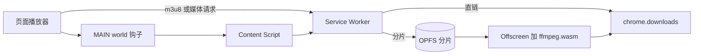

# Chrome 视频下载扩展方案

状态：方案，未开工。  
形态：Manifest V3 扩展，TypeScript，工程用 [WXT](https://wxt.dev/)。  
处理全部在本机完成，不把播放地址上传到自建服务器。

## 1. 目标

用户打开任意播放页并开始播放后，扩展认出当前页的媒体地址，在工具栏给出条数。点开图标能看到列表，选一条保存到本地。

要覆盖两类资源：

- 直链：`mp4`、`webm`、`mp3`、`m4a` 等，浏览器已经能直接播的文件。
- HLS：主播放列表或媒体播放列表（m3u8）。点播把分片下完，封装成一个 MP4。直播持续追新分片，用户停止后再封装。

交互对齐 CocoCut 的主路径：先播放才能发现、角标计数、列表里下载、HLS 合并成 MP4、直播可录、普通下载失败时再考虑录制。录制放在第三期。

## 2. 范围

第一期做这些：

- 用户对当前站点授权后才嗅探。
- 按标签页列出嗅探到的直链和 m3u8。
- 直链经 `chrome.downloads` 保存，带上该站 Cookie 和播放页 Referer。
- HLS 点播：主列表选清晰度，下载全部分片，支持 MPEG-TS 和 fMP4（`#EXT-X-MAP`）。
- 播放列表里 `METHOD=AES-128` 且带了密钥 URI 的，密钥和分片一起下载，封装时解密。
- 同一清晰度下视频、音频分轨（`#EXT-X-MEDIA`）时，两路都下完再封装。
- 进度、取消、失败原因。

第二期：

- HLS 直播：播放列表没有 `#EXT-X-ENDLIST` 时轮询、按序号去重、手动停止后封装。
- DASH（`.mpd`）。
- 断点续下、只保存音轨。

第三期再决定：

- 录制模式：`chrome.tabCapture` 加 `MediaRecorder`。必须用户手势，Chrome 会显示正在共享。时长等于播放时长，画质是画面已经渲染出来的结果。
- 单个站点的签名适配。每个站点单独一个适配器，不写进通用内核。

本期不做：

- Widevine、FairPlay、PlayReady，以及 `SAMPLE-AES`、`KEYFORMAT` 指向 DRM 的 HLS。密钥在 CDM 里，播放列表拿不到。
- YouTube、B 站这类短时签名或自有地址混淆的站点适配。通用嗅探能抓到什么就列什么，抓不到不专项破解。
- 转码、去广告。`#EXT-X-DISCONTINUITY` 两侧原样保留。
- 把地址或分片传到扩展作者的服务器。

## 3. 架构



四个运行单元：

| 单元 | 职责 |
|---|---|
| Service Worker | `chrome.webRequest` 嗅探；按标签页保存资源；下载队列；把任务状态放进 `chrome.storage.session`。Worker 会被回收，大文件和 ffmpeg 不放这里。 |
| MAIN world 脚本 | 钩住页面的 `fetch` 和 `XMLHttpRequest`，把疑似媒体 URL 报上来。只上报地址，不在页面里下大文件。 |
| Content Script | 读 `<video>` / `<audio>` 的 `currentSrc` 和页面标题。`blob:` 丢掉。把播放页 URL 当作后续请求的 Referer。 |
| Offscreen Document | 跑 ffmpeg.wasm，生成输出文件。MV3 的 Worker 不能稳定持有大 Blob，封装放这里。 |

消息只走扩展内部：`chrome.runtime.sendMessage` / 长连接 `Port`。封装期间 Port 保持，避免 Worker 在中途被回收后任务丢失。分片字节进 OPFS，不进消息体。

## 4. 嗅探

一条候选资源的来源有三个，后到的补全先到的字段，不重复插列表：

1. `chrome.webRequest.onResponseStarted` 或 `onCompleted`。扩展要同时拥有请求 URL 和 initiator 的 host 权限才看得见。
2. MAIN world 钩子看到的 `fetch` / XHR URL。用来补没有标准后缀、Content-Type 也不标准的 m3u8。
3. Content Script 扫到的元素 `currentSrc`。只收 `http:` / `https:`。

判定为媒体，满足任意一条即可：

- 路径以 `.m3u8`、`.mpd`、`.mp4`、`.webm`、`.m4s`、`.ts`、`.m4a`、`.mp3` 结尾。单独的 `.ts` 分片不进列表，只在已经认领的播放列表任务里下载。
- 响应头 `Content-Type` 为 `application/vnd.apple.mpegurl`、`application/x-mpegURL`、`application/dash+xml`、`video/*`、`audio/*`。
- 响应体开头是 `#EXTM3U`。只对前两类还不确定的请求读一小段，不扫描全部流量。

去重：

- 列表展示键是「标签页 + URL 的 path」。同一个播放列表被换了签名 query 时，只保留最近一条。
- 真正下载用最近一次完整 URL，query 原样保留。签名通常几分钟失效，所以嗅探到之后马上能下，不把「只存 path、以后再下」当成可靠路径。

每个标签页维护自己的列表。标签关闭时丢掉该页资源和未开始的任务；已经在下的任务继续，直到完成或用户取消。工具栏 badge 显示当前标签页的条数。很多站点必须先点播放，地址才会出现，空列表时文案说明这一点。

资源字段：

```ts
type MediaKind = "file" | "hls" | "dash";

type SniffedMedia = {
  id: string;
  tabId: number;
  pageUrl: string;
  pageTitle: string;
  url: string;          // 最近一次完整地址，含 query
  pathKey: string;      // 去重用，不含 query 和 fragment
  kind: MediaKind;
  mime?: string;
  referer: string;      // 播放页 URL
  detectedAt: number;
};
```

`dash` 第一期只展示，标记为第二期再下载。

## 5. 下载任务

```ts
type JobState =
  | "queued"
  | "resolving"   // 拉播放列表、选清晰度
  | "fetching"    // 下分片
  | "muxing"
  | "saving"      // chrome.downloads
  | "done"
  | "failed"
  | "cancelled";

type Variant = {
  uri: string;
  bandwidth?: number;
  resolution?: string;  // 如 1920x1080
  codecs?: string;
  audioGroupId?: string;
  fps?: number;
};

type DownloadJob = {
  id: string;
  mediaId: string;
  tabId: number;
  state: JobState;
  variant?: Variant;
  progress: { done: number; total: number };
  bytesDone: number;
  filename?: string;
  error?: string;       // 给用户看的短原因，不带 Cookie 和密钥
  createdAt: number;
};
```

状态只按上面的顺序往前走。`cancelled` 可以在 `saving` 之前切入：停掉在飞的请求，删 OPFS 目录。`failed` 保留已下分片到用户点「清除」或开始新任务覆盖。

直链没有 `resolving` / `muxing`，从 `fetching` 到 `saving`。直链优先把 URL 交给 `chrome.downloads.download`，由浏览器自己拉。若目标站校验 Referer 导致浏览器下载失败，再改由扩展 `fetch` 落临时文件后交给 downloads。

并发：全局同时一个封装任务；分片下载并发 4，单分片失败重试 3 次，超时 20 秒。数字做成常量，方便以后放进设置。

## 6. HLS 点播

1. 用第 7 节的身份拉取播放列表文本。
2. 出现 `#EXT-X-STREAM-INF` 就是主列表。解析每路的带宽、分辨率、编码、帧率、音频组，按带宽从高到低排序。默认选最高，弹层里可以改。
3. 再拉选中的媒体列表。有 `#EXT-X-ENDLIST` 才走点播；没有则第一期直接失败并提示「直播留到下一期」，避免把滑动窗口当成完整文件。
4. `#EXT-X-MAP` 是 fMP4 的初始化段，必须先下，每个媒体列表一份。
5. `#EXT-X-KEY`：`METHOD=NONE` 跳过；`METHOD=AES-128` 且 `URI` 可拉取时，把密钥存成 `key.bin`。`METHOD=SAMPLE-AES` 或带 DRM 的 `KEYFORMAT` 把任务标为不支持。
6. 展开分片 URL（处理相对路径和 `#EXT-X-BYTERANGE`）。按序号写入 OPFS。
7. 在任务目录写一份本地 m3u8：分片和密钥都改成相对路径，供 ffmpeg 读取。
8. Offscreen 里执行 ffmpeg.wasm，`-c copy` 输出 MP4，不转码。
9. `chrome.downloads.download` 保存。文件名用页面标题加分辨率，去掉路径字符。完成后删除该任务的 OPFS 目录。

音视频分轨：媒体列表通过 `AUDIO` 组指向另一条播放列表时，音频走同一套分片下载，封装时作为第二路输入，同样 `-c copy`。

本地目录：

```text
opfs://jobs/<jobId>/
  source.m3u8      # 改写后的媒体列表
  audio.m3u8       # 有分轨时才有
  key.bin
  audio.key.bin
  init.mp4         # 有 EXT-X-MAP 时
  seg/00001.ts
  audio/00001.ts
  out.mp4
```

进度用「已完成分片数 / 分片总数」。封装阶段总数未知字节时，进度停在 90%，完成后到 100%。ffmpeg.wasm 在浏览器里的输出大约到 2GB 会失败，超过时任务失败，文案写明是体积上限。

## 7. 请求身份

扩展后台的 `fetch` 默认不带播放页的 Referer，源站也经常不是扩展自己的源。两个问题分开处理：

- Cookie：声明了目标 host 权限后，`fetch(url, { credentials: "include" })` 会带上该站 Cookie。
- Referer 和 Origin：下载开始时用 `chrome.declarativeNetRequest.updateSessionRules` 加一条会话规则，只作用于这次任务的分片和播放列表 URL，把 `Referer` 设为播放页、`Origin` 设为播放页的源。任务结束或取消时删掉规则。

站点权限用 `optional_host_permissions`，不默认要 `<all_urls>`。用户在弹层里对当前站点点授权。嗅探到的分片若落在别的 CDN 域名，接着用 `chrome.permissions.request` 申请那个源，未授权则这条资源标为「需要授权 CDN」而不是静默失败。

密钥、Cookie、带签名的完整 query 不写日志。日志里只留 host 和 path 模板。

## 8. 封装

ffmpeg.wasm 随扩展打包。商店不允许从远程拉可执行代码或 wasm。扩展 CSP 需要 `wasm-unsafe-eval`。

只用封装和封装所需的解复用，不做转码。发布时选用 LGPL 的精简构建；全量官方包是 GPL，若改用全量包，仓库许可证要跟着换成 GPL，并保留 ffmpeg 的许可证文本。

Offscreen 的创建理由用 `BLOBS`。同一时间只开一个 offscreen 文档。输入从 OPFS 读，输出写回 OPFS 的 `out.mp4`，再交给 `chrome.downloads`。

## 9. 清单与权限

```json
{
  "manifest_version": 3,
  "permissions": [
    "webRequest",
    "downloads",
    "storage",
    "unlimitedStorage",
    "offscreen",
    "scripting",
    "tabs",
    "declarativeNetRequest"
  ],
  "optional_host_permissions": ["http://*/*", "https://*/*"],
  "host_permissions": []
}
```

`unlimitedStorage` 给 OPFS / IndexedDB 里的分片用。`scripting` 用来在用户授权后把 MAIN world 钩子注进当前页。

弹层是扩展页，不是注入到播放页上的浮层，避免和站点样式、CSP 缠在一起。第一期页面：当前站点授权按钮、资源列表、清晰度、进度。

## 10. 工程结构

开工时按这个摆，WXT 的入口名以生成结果为准，职责不变：

```text
chrome-video-downloader/
  docs/方案.md
  entrypoints/
    background.ts          # webRequest、队列、权限
    content.ts             # 元素扫描，隔离世界
    injected.ts            # MAIN world，钩 fetch / XHR
    popup/                 # 列表和进度
    offscreen/             # ffmpeg 封装
  src/
    sniff/                 # 判定、去重、合并三路来源
    hls/                   # m3u8 解析、本地列表改写、分片计划
    fetch/                 # 带 Cookie 的下载、DNR 会话规则
    job/                   # 状态机、OPFS 布局
    mux/                   # 调用 offscreen 的封装参数
  wxt.config.ts
```

播放列表解析自己写一个小解析器，覆盖主列表、媒体列表、`EXT-X-MAP`、`EXT-X-KEY`、`EXT-X-MEDIA`、`EXT-X-BYTERANGE`、相对 URL。不引入完整的 hls.js，那个库是播放器，不是下载器。

## 11. 分期验收

第一期用公开测试流验收，不绑具体商业站点。可用 [Mux 的测试流](https://test-streams.mux.dev/) 里带主列表、多码率的点播 m3u8。

| 项 | 验收 |
|---|---|
| 授权 | 未授权时列表为空，且没有 host 权限。授权当前站之后能看到该站媒体。 |
| 直链 | 测试页上的 mp4 能保存，文件可播放。 |
| 多码率 | 主列表列出两路以上，默认最高，改选低一路后输出分辨率对应那一路。 |
| fMP4 或 TS | 至少一种分片形态封装成 MP4，本地播放器能播完，音画同步。 |
| AES-128 | 用带 `#EXT-X-KEY:METHOD=AES-128` 的公开样例，输出可正常播放。 |
| 分轨 | 视频、音频分开的样例，输出里两路都在。 |
| 取消 | 下载中途取消后，没有残留 downloads 项，OPFS 任务目录被删。 |
| 失败 | CDN 未授权、DRM、直播列表，各自有明确文案，而不是一直转圈。 |
| 隐私 | 网络面板里看不到扩展把 m3u8 地址发往第三方。 |

第二期验收再加：直播录 30 秒后停止，得到可播放 MP4；DASH 点播样例同样能封装。

第三期录制模式单独验收：共享指示条出现，停止后得到 webm 或 mp4，时长接近录制时长。

## 12. 风险

- 商店审核：可以上架，隐私政策要写明只在本地处理。远程脚本和远程 wasm 会被拒。默认申请全部网站权限会让审核和安装提示都更严，所以用可选权限。
- 短时签名：query 里的 token 很快失效。列表保存最近一次完整 URL，用户隔太久再点下载会失败，提示重新播放以刷新地址。
- 分片在别的域名：没申请到 CDN 权限时明确失败。
- Worker 回收：任务元数据在 `chrome.storage.session`，分片在 OPFS。封装过程用 Port 占住 Worker。浏览器整个退出则任务作废，第一期不恢复半成品。
- 内存：封装阶段整段输出在 wasm 内存里，大约 2GB 上限。第一期不实现流式写盘之外的再拆分。
- 广告切片：第一期不去。后续若做，只按播放列表标记跳过，不做画面识别。

## 13. 参考

- CocoCut 的公开说明：嗅探、HLS 合并 MP4、直播、录制兜底。产品行为对齐，代码和站点名单不照搬。
- Chrome `webRequest`：MV3 仍可观察请求；`webRequestBlocking` 普通扩展没有。本方案不需要拦截改写响应，只观察。
- [hls-downloader](https://github.com/puemos/hls-downloader)：MV3、分片进本地存储、offscreen 里 ffmpeg 封装。
- [media-bridge](https://github.com/jvillegasd/media-bridge)：HLS / DASH / 直链，同样是嗅探加本地封装，并写明大约 2GB 的合并上限和 DRM 下不了。
